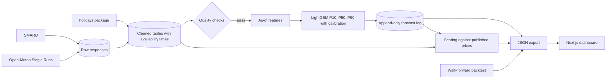

# German day-ahead electricity price forecast

Every morning before the auction closes, this project forecasts the next day's hourly wholesale electricity prices for the DE-LU bidding zone. Once actual prices are published, it scores the forecast and adds it to a public track record.

**Live dashboard: [depower.abdulhabeeb.com](https://depower.abdulhabeeb.com)**

The dashboard is available in English and German, following the browser's language.

## Results

Walk-forward backtest over 365 days, 1 November 2025 to 31 October 2026. The model was retrained monthly on earlier data only. These are simulated forecasts, not live results; the [dashboard](https://depower.abdulhabeeb.com/track-record/) keeps the two separate.

| Forecast | MAE (EUR/MWh) | RMSE (EUR/MWh) | sMAPE | P10–P90 coverage (target 80%) |
|---|---:|---:|---:|---:|
| **LightGBM (P50)** | **19.10** | **31.07** | **29.5%** | 77.9% |
| Same hour, previous day | 31.28 | 48.86 | 44.2% | 75.7% |
| Same hour, last week | 40.17 | 61.61 | 52.0% | 75.3% |

The model's MAE is 12.18 EUR/MWh below the previous-day baseline (95% interval 10.27 to 14.10) and 21.07 below the last-week baseline (18.55 to 23.57), resampling whole days. Baselines only give single numbers, so their ranges come from their own errors over the previous 90 days.

### Where it falls short

| Period | Hours | Model MAE | Previous-day MAE | Model coverage |
|---|---:|---:|---:|---:|
| Highest 5% of prices (≥ 215.72 EUR/MWh) | 438 | 65.90 | 73.06 | 54.3% |
| Negative prices | 462 | 25.16 | 41.53 | 81.0% |
| Middle 90% of prices | 7,860 | 16.13 | 28.35 | 79.0% |

- **Price spikes are the main weakness.** The model beats the baseline only narrowly there, and the range misses nearly half of those hours.
- **Errors rose late in the test.** MAE was 31.8 in September and 32.6 in October 2026, against 11.3 to 20.1 in the other months.
- **The evening peak is hardest.** MAE reaches about 27.5 at 19:00 and 20:00 Berlin time.
- **Raw ranges were too narrow.** The first backtest covered only 58.5% of prices, so I added conformal calibration. Because that decision followed the result, the 77.9% may be slightly flattering. Calibration does not change P50 or MAE.

The [Model page](https://depower.abdulhabeeb.com/model/) has the full breakdown by hour and month, plus feature importance.

## How leakage is prevented

A forecast is only honest if it uses what was known at the time. The cutoff is **11:30 Berlin time on the day before delivery**, 30 minutes before the 12:00 auction.

| Input | What it can see | Why |
|---|---|---|
| Prices | Through the day before delivery | Published the previous afternoon |
| Demand forecast | The delivery day | Published by about 10:00 on the day before |
| Wind and solar forecasts | Through the day before delivery only | The delivery-day values appear to be published after the auction closes |
| Actual demand and generation | Through two days before delivery | A conservative buffer |
| Weather | ECMWF run from 00 UTC on the day before | A fixed issue time, 22 to 47 hours ahead of delivery |
| Calendar and holidays | Everything | Known in advance |

- **Feature code cannot reach newer data.** Every cleaned row carries an `available_at_utc` time, and features can only read through an as-of view that hides anything newer than the cutoff.
- **Tests try to break it.** They overwrite every post-cutoff value with an absurd number and confirm that no feature changes.
- **Real data is audited too.** None of the 23,136 feature rows uses an input from after its cutoff.
- **Two tempting weather sources were rejected.** Open-Meteo's Historical Forecast API joins the first hours of successive runs, which can include runs from after the cutoff. Its `previous_day1` fields can too.

## Architecture



Raw responses are kept unchanged and stored as a new version only when they change, so ingestion is idempotent and values can be rebuilt. Timestamps are stored in UTC and shown in Europe/Berlin, and 23-hour and 25-hour days are tested explicitly.

### Daily schedule

Systemd timers on a Hetzner server run the jobs in containers. GitHub Actions runs CI and a temporary publication-time poller. Scheduling moved to the server because the cutoff is strict, GitHub's scheduled runs can start late, and the database needs permanent storage.

| Berlin time | Job |
|---|---|
| 10:20, 10:45, 11:10 | Ingest, run quality checks and forecast. A logged day is never redone |
| 11:35 | If no run succeeded, record the day as missed |
| 14:05, 20:35 | Ingest published prices, score earlier forecasts and export |

A forecast is written once, to one file per delivery date, and each entry stores the hash of the one before it. `epf verify-log` checks that chain, and CI fails if a logged forecast is changed. A late or incomplete run publishes nothing, and the dashboard flags old data rather than presenting it as new. A missed day or a failed job also sends an email alert. Retries before the cutoff stay quiet.

### Forecast resolution

SMARD's prices are hourly until 30 September 2025 and 15-minute from delivery on 1 October 2025, when the European day-ahead market changed. The earlier 15-minute series only repeats the hourly value. Forecasts here are **hourly**, which gives one consistent target across the training history. The hourly price matches the mean of its four quarters to within rounding. Prices within an hour differ by a mean of 23.97 EUR/MWh, and hourly forecasts cannot capture that.

## Run it yourself

You need [uv](https://docs.astral.sh/uv/), Node.js 22 or later, and on macOS `brew install libomp` for LightGBM. No API keys are required.

**Try the dashboard with synthetic data, in about a minute:**

```bash
make setup
make sample   # writes clearly labelled sample data
make dev      # http://localhost:3000
```

Production builds refuse to run if sample data is present.

**Run the whole pipeline on real data:**

```bash
make all
```

The first run takes about 2 hours, because the weather backfill of roughly 960 model runs stays inside Open-Meteo's free limits. It can resume if interrupted.

**Run the checks:**

```bash
make test
make lint
cd pipeline && uv run pytest -m live   # contract tests against the real APIs
```

`.env.example` lists the optional settings. Server setup is in [`deploy/`](deploy/).

## Data sources

Details below were confirmed with live requests on 2 November 2026.

### SMARD (Bundesnetzagentur)

- **Endpoint:** `https://www.smard.de/app/chart_data/{filter}/DE/{filter}_DE_{resolution}_{timestamp}.json`, served as weekly chunks listed by an index file. There is no official API documentation or stated rate limit; a [community spec](https://github.com/bundesAPI/smard-api) describes it.
- **Units:** energy is in MWh per interval, converted here to average MW.

| Series | Filter | Used for |
|---|---:|---|
| Day-ahead price, DE-LU | 4169 | Target, lagged prices, baselines |
| Demand forecast | 411 | Delivery-day feature |
| Actual demand | 410 | Lagged feature |
| Residual load | 4359 | Lagged feature |
| Wind onshore, offshore, solar forecasts | 123, 3791, 125 | Previous-day features only |
| Wind onshore, offshore, solar actuals | 4067, 1225, 4068 | Lagged features |

Filter 411 is not listed in the community spec. Its identity is inferred from its behaviour: it tracks actual demand and extends into the future.

**Licence and attribution:** SMARD's data is licensed under CC BY 4.0, credited as "Bundesnetzagentur | SMARD.de". However, [its terms](https://www.smard.de/en/datennutzung) currently say wholesale price data should not be reused until further notice, while licensing is reviewed under the HEDWIG proceedings. This project publishes those prices with attribution as a deliberate decision by its owner, knowing that notice. If you reuse this project, check the current terms yourself. Raw market data is not stored in this repository.

### Open-Meteo

- **Endpoint:** Single Runs API, `https://single-runs-api.open-meteo.com/v1/forecast`, with `models=ecmwf_ifs` and a required `run` time. History starts on 14 March 2024.
- **Data:** wind speed at 100 m, shortwave radiation, temperature and cloud cover at six locations across Germany.
- **Licence:** CC BY 4.0, "Weather data by [Open-Meteo.com](https://open-meteo.com/)". The free tier is for non-commercial use, limited to 10,000 calls a day, 5,000 an hour and 600 a minute.

### Public holidays

Comes from the offline [`holidays`](https://github.com/vacanza/holidays) Python package, cross-checked against Nager.Date in a contract test. Regional holidays are weighted by the share of the 16 states observing them, not by population or demand.

## Limitations

- **Live record is new.** Results above are from a backtest. Only the live track record shows how the model performs in practice.
- **Availability times are partly assumed.** SMARD keeps no history of revisions or publication times, so past availability comes from conservative rules based on one day of file timestamps. A poller is measuring real publication times. Backtests also use the latest revision of each value.
- **Weather history may flatter results.** The early archive uses hindcasts from a newer ECMWF model version than was running at the time. The model version also changed in May 2026. Two delivery days in August 2025 have no usable weather run.
- **Inputs are limited.** Plant outages, fuel and carbon prices, and neighbouring markets are not included, so shocks only show up through later prices.
- **EV calculator:** it uses wholesale prices and excludes taxes, grid fees and supplier charges. The plug-in window must also fall within one day, since prices are only known one day ahead.
- **Not financial advice.** Do not rely on these forecasts for trading or other financial decisions.

## Future ideas

- Forecast 15-minute prices by adding a within-hour shape model.
- Add gas and carbon prices, plant outages and neighbouring markets, if licences allow.
- Model price spikes separately, since that is where the current model is weakest.
- Compare other weather models, and use the latest run available at the cutoff.

## Project layout

```text
pipeline/src/epf/   ingest, clean, quality, features, models, live, cli
pipeline/tests/     parsing, daylight saving, leakage, metrics, forecast log
dashboard/          Next.js static export, built with shadcn/ui
data/forecast_log/  append-only live forecasts
data/backtest/      aggregate backtest report
deploy/             containers, systemd timers, job script
```
